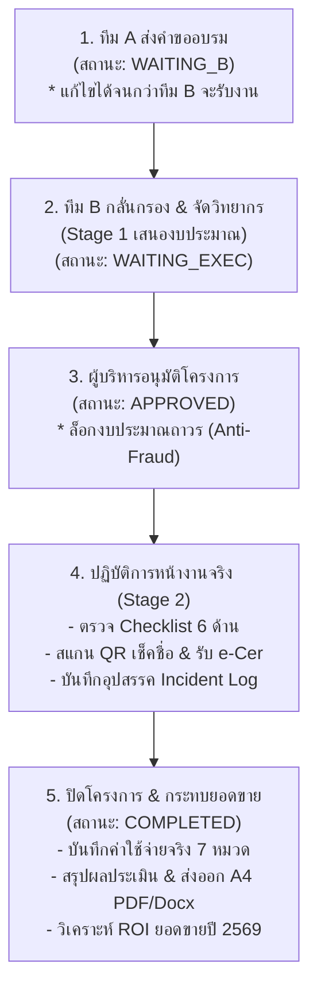

# คู่มือการใช้งาน Training Center TWP (Enterprise Operations & Audit Governance Manual)

**เวอร์ชันระบบ:** 1.21.0 (Enterprise Edition)  
**ระบบ:** Training Center TWP - แพลตฟอร์มบริหารคำขอจัดอบรม ปฏิบัติการหน้างาน และวิเคราะห์ผลกระทบยอดขายปิดลูป  
**Production Apps Script Endpoint:** `https://script.google.com/macros/s/AKfycby-D2AvgHXO_y4tVxg8wgkDP9ARBnRpiVp47-vnF7AiA1TA4AqwKGbelJTyI68tKfmx6g/exec`  
**รหัสผ่านผู้ดูแลระบบ (Admin Password):** `admin0000`

---

## 🌟 ไฮไลต์ฟีเจอร์ใหม่ในเวอร์ชัน 1.21.0 (Enterprise Operations & Governance)

### 1. กล่องเตือนงานค้างสำหรับทุกทีม (Role-Based Action Inbox)
- แก้ปัญหาการทำงานต่างเวลา (Asynchronous Collaboration): เมื่อฝ่ายขาย (ต่างจังหวัด), ทีมวิชาการ (ส่วนกลาง), หรือผู้บริหารเปิดระบบขึ้นมาเวลาใดก็ตาม แถบ Action Inbox ด้านบนสุดจะสรุปจำนวนงานค้างของทุกทีมทันที
- สรุปตัวเลขงานค้าง 3 ฝ่าย:
  - 🟢 **ทีม A (ฝ่ายขาย):** คำขอที่รอส่งต่อ/รอการตรวจสอบ
  - 🟣 **ทีม B (วิชาการ):** คำขอรอจัดสรรวิทยากร (Stage 1) / งานรอ Checklist และจัดอบรมจริง (Stage 2)
  - 🔵 **ฝ่ายบริหาร (Executive):** คำขอรออนุมัติงบประมาณ
- คลิกการ์ดของแต่ละฝ่ายเพื่อสลับหน้าจอไปยังคิวงานนั้นได้ทันที 1 คลิก

### 2. วงจรควบคุมคำขอฝ่ายขาย (Team A Tracking & Pre-Approval Edit)
- **ตารางติดตามคำขอที่บันทึกแล้ว (My Requests Tracking):** แสดงคำขอทั้งหมดที่ทีม A บันทึก พร้อมสถานะการรับงานของทีม B แบบ Real-time
- **สิทธิการแก้ไขก่อนรับงาน (`[ ✏️ แก้ไขคำขอ ]`):** ตราบใดที่สถานะยังเป็น `WAITING_B` ทีม A สามารถกดแก้ไขเพื่อโหลดข้อมูลกลับเข้าฟอร์ม ปรับแก้หัวข้อ โรงเรียน วันที่ หรือรายละเอียด และบันทึกซิงค์ตรงเข้าคิวทีม B ได้ทันที
- **ใบตอบรับการส่งงาน (Submission Receipt Alert):** แจ้งเตือนยืนยันรหัสคำขอและขั้นตอนถัดไปอย่างชัดเจน ไม่สร้างความสับสน

### 3. มาตรการล็อกงบประมาณและธรรมาภิบาลข้อมูล (Strict Post-Approval Freeze & Audit Governance)
- **ระบบล็อกงบประมาณ (Anti-Fraud Lock):** เมื่อผู้บริหารอนุมัติโครงการแล้ว (`APPROVED` หรือ `COMPLETED`) ระบบจะล็อกข้อมูลสำคัญ (งบประมาณ, ยอดขายเป้าหมาย, โรงเรียน, หัวข้อ) ทันที ห้ามแก้ไขโดยพลการ เพื่อป้องกันความคลาดเคลื่อนและการทุจริตงบประมาณ
- **ระบบขอปรับปรุงหลังอนุมัติ (Audit Revision Trail):** หากมีความจำเป็นต้องเปลี่ยนแปลง จะต้องกดปุ่ม `[ 📝 ขอปรับแก้ ]` เพื่อกรอกผู้ขอปรับปรุง หมวดหมู่ และเหตุผลความจำเป็นอย่างเป็นทางการ ซึ่งระบบจะประทับเวลาและบันทึกเข้าตาราง `Audit_Logs` ในฐานข้อมูล Google Sheets

### 4. แท่นตรวจความพร้อม 6 เสาหลัก (Team B 6-Pillar Operation Readiness Checklist)
- สำหรับโครงการที่อนุมัติแล้ว ทีมวิชาการมี Checklist ตรวจสอบความพร้อมหน้างาน 6 ด้าน:
  1. 🏢 **สถานที่ & ระบบโสตฯ:** ห้องอบรม ไมโครโฟน โปรเจกเตอร์ จอฉาย
  2. 📚 **เอกสาร & สื่อคู่มือ:** เอกสารประกอบการสอน สมุด ปากกา สื่อสาธิต
  3. 🚩 **บูธจัดแสดง & ป้ายงาน:** แบนเนอร์ ป้ายชื่อหน้าห้อง ขาตั้งประชาสัมพันธ์
  4. 👨‍🏫 **วิทยากร & ที่พัก/เดินทาง:** การเดินทาง ตั๋ว รถรับ-ส่ง โรงแรมที่พัก
  5. ☕ **อาหาร & กาแฟเบรก:** อาหารกลางวัน ของว่างเบรกเช้า-บ่าย
  6. 📱 **จุดสแกนเช็คชื่อ & e-Cer:** QR สแตนด์เช็คชื่อหน้างาน และระบบ e-Certificate
- มีแถบวัดระดับความพร้อม (%) และบันทึกซิงค์ตรงกับฐานข้อมูลส่วนกลาง

### 5. สมุดบันทึกอุปสรรคและบทเรียนหน้างาน (On-Site Incident & Obstacle Logger)
- ทีม B สามารถบันทึกปัญหาเฉพาะหน้าที่เกิดขึ้นระหว่างจัดอบรมจริงได้ทันที เช่น ไฟดับ, อุปกรณ์แปลงสัญญาณไม่รองรับ, ผู้เข้าร่วมมาช้ากว่ากำหนด พร้อมระบุแนวทางแก้ไขเฉพาะหน้า
- ข้อมูลจะถูกรวบรวมเป็น **"สมุดบันทึกอุปสรรคและบทเรียนหน้างานประจำปี 2569"** แสดงบนหน้าจอผู้บริหาร (Executive Dashboard) เพื่อใช้ประเมินความสามารถและป้องกันปัญหาซ้ำในปีต่อไป

### 6. การเชื่อมโยง Google Sheets ข้ามบัญชี (Multi-Account Shared Sheets)
- ฝ่ายเทคนิคหรือฝ่ายบัญชีสามารถตั้งค่า `SECONDARY_FINANCE_SHEET_ID` และ `SECONDARY_AUDIT_SHEET_ID` ใน `backend_code.gs` เพื่อแยกเก็บข้อมูลการเงินและตรวจสอบข้าม Google Account ได้อย่างปลอดภัย

---

## 📋 ขั้นตอนการทำงาน 5 ขั้นตอน (5-Stage Operational Workflow)

---

## 🛠️ รายละเอียดการปฏิบัติงานแต่ละฝ่าย

### ฝ่ายขาย (Sales Team A)
1. **ยื่นคำขอ:** กรอกแบบฟอร์มคำขอจัดอบรม (เลือกโครงการอนุมัติหลักการประจำปี หรือ ระบุเหตุผลขอนอกแผน)
2. **ส่งคำขอ:** กดปุ่ม *"ส่งคำขอให้ฝ่ายวิชาการ (ทีม B) ตรวจสอบ"* ระบบจะสร้างรหัส `EVT-YYYYMMDD-XXXX`
3. **ติดตามและแก้ไข:** เลื่อนลงมาที่ตาราง *"ทะเบียนคำขอที่บันทึกแล้ว"* ด้านล่าง
   - หากทีม B ยังไม่ได้รับงาน จะมีปุ่ม `[ ✏️ แก้ไขคำขอ ]` สามารถกดเพื่อปรับแก้ข้อมูลได้ตลอดเวลา
   - เมื่อกดแก้ไข ฟอร์มจะแสดงแถบสีส้มด้านบน เมื่อแก้ไขเสร็จกด *"บันทึกการแก้ไขคำขอ"*

### ฝ่ายวิชาการและจัดอบรม (Academic Team B)
1. **Stage 1 (กลั่นกรองคำขอ):** เข้าแท็บ "ทีม B" เลือกดูรายการในคิว `Pending Review`
   - ตรวจสอบความเหมาะสม จัดสรรวิทยากร เสนอหมวดงบประมาณ และกดส่งให้ผู้บริหาร
2. **Stage 2 (ปฏิบัติการจัดงานจริง):**
   - **QR เช็คชื่อหน้างาน:** นำ QR Code จุดลงทะเบียนฉายขึ้นจอหรือพรินต์ตั้งหน้าห้อง เพื่อให้ครูผู้เข้าร่วมสแกนเช็คชื่อและรับสิทธิ์ e-Certificate
   - **Checklist 6 ด้าน:** ติ๊กตรวจความพร้อม สถานที่, เอกสาร, แบนเนอร์, วิทยากร, อาหาร, และจุดสแกน
   - **Incident Log:** หากเกิดปัญหาหน้างาน กดบันทึกอุปสรรคและวิธีแก้ปัญหาเฉพาะหน้า
   - **สรุปค่าใช้จ่าย:** บันทึกใบเสร็จค่าใช้จ่ายจริง 7 หมวดตามระเบียบบริษัท

### ฝ่ายบริหารและบัญชี (Executive & Audit)
1. **พิจารณาอนุมัติงบ:** ตรวจสอบคำขอที่ผ่านการกลั่นกรองจากทีม B กด "อนุมัติ" หรือ "ส่งกลับแก้ไข"
2. **ตรวจสอบ Audit Log:** เข้าดูประวัติการขอปรับปรุงโครงการผ่านระบบ Audit Trail
3. **สมุดบันทึกอุปสรรค (Incident Ledger):** เข้าดูรายงานปัญหาหน้างานและวิธีแก้ไขของทีมวิชาการ เพื่อประเมินผลการดำเนินงานและวางแผนป้องกันในปีถัดไป
4. **กระทบยอดขาย 2569:** นำเข้าไฟล์ Excel ยอดขายจริง เพื่อเปรียบเทียบกับเป้าหมายของแต่ละโรงเรียนที่จัดอบรม

---

## 📦 วิธีการอัปโหลดไฟล์ขึ้น GitHub (แบบลากและวาง / Drag-and-Drop)

ไม่ต้องใช้คำสั่ง Git Command Line ที่ยุ่งยาก! ได้จัดเตรียมไฟล์ทั้งหมดไว้ในโฟลเดอร์ **`FOR_GITHUB_UPLOAD/`** เรียบร้อยแล้ว:

1. เปิดเว็บไซต์ **GitHub** ในเว็บเบราว์เซอร์ ไปที่ Repository ของโครงการ
2. กดปุ่ม **"Add file"** &rarr; เลือก **"Upload files"**
3. เปิดโฟลเดอร์ `c:\Users\nipon\OneDrive\Test app\Training app\FOR_GITHUB_UPLOAD` ในคอมพิวเตอร์
4. ลากไฟล์ทั้งหมดในโฟลเดอร์นั้น ไปวางลงในช่องอัปโหลดบนหน้าเว็บ GitHub:
   - `index.html`
   - `register.html`
   - `survey.html`
   - `404.html`
   - `.nojekyll`
   - `backend_code.gs`
   - `VERSION`
   - `MANUAL.md`
   - `README_DRAG_AND_DROP.txt`
5. เลื่อนลงมากดปุ่มสีเขียว **"Commit changes"**
6. เว็บไซต์ GitHub Pages จะอัปเดตเป็นเวอร์ชัน 1.21.0 ทันทีภายใน 1-2 นาที

---

## 🔐 การอัปเดต Google Apps Script Backend (GAS)
1. เข้าไปที่ Google Apps Script Editor ของโครงการ
2. เปิดไฟล์ Code.gs แล้วคัดลอกโค้ดจาก `backend_code.gs` ทั้งหมดไปวางแทนที่
3. กดปุ่ม **"บันทึก" (Save)**
4. กด **"ทำให้ใช้งานได้" (Deploy) &rarr; "จัดการการทำให้ใช้งานได้" (Manage deployments)**
5. กดไอคอนดินสอ เลือก Version เป็น **"เวอร์ชันใหม่" (New version)** แล้วกด **"ทำให้ใช้งานได้" (Deploy)**
