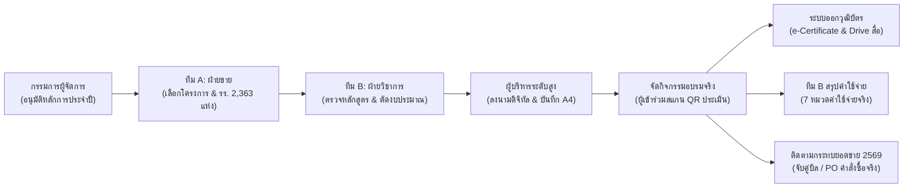

# สรุปโครงสร้างระบบและคู่มือสถาปัตยกรรมการทำงานฉบับสมบูรณ์
## EMS Enterprise Training Workflow & Commercial Sales Reconciliation System (v1.15.0)
**บริษัท ไทยวัฒนาพานิช จำกัด (TWP)**

---

## 1. วัตถุประสงค์และภาพรวมของระบบ (System Overview)

ระบบ **EMS Enterprise (Enterprise Management System)** พัฒนาขึ้นเพื่อเป็นแพลตฟอร์มดิจิทัลแบบครบวงจร (Closed-Loop Platform) สำหรับบริหารจัดการกิจกรรมการฝึกอบรมพัฒนาวิชาชีพครู การกลั่นกรองงบประมาณ การกำกับดูแลเวลาปฏิบัติการ (SLA) การติดตามค่าใช้จ่ายจริง 7 หมวด การประเมินผลความพึงพอใจด้วยวุฒิบัตรอิเล็กทรอนิกส์ (e-Certificate) ตลอดจนการกระทบยอดขายจริงเชิงพาณิชย์ (Sales Impact Reconciliation) ในปีงบประมาณ 2568 - 2569



---

## 2. โครงสร้างโมดูลหลัก 8 แท็บการทำงาน (Main Modules Breakdown)

ระบบถูกออกแบบในลักษณะ Single Page Application (SPA) แบ่งการทำงานออกเป็น 8 แท็บหลักที่เชื่อมโยงกันอย่างเป็นเอกภาพ:

```
[Dashboard] ──> [1. โครงการอนุมัติหลักการ] ──> [2. ทีม A ขอจัด] ──> [3. ทีม B ตรวจ] ──> [4. ผู้บริหารอนุมัติ] 
                ──> [5. QR & ประเมิน] ──> [6. ทีม B สรุป 7 ค่าใช้จ่าย] ──> [7. กระทบยอดขายปี 2569]
```

### 1) Dashboard & Analytics (ศูนย์ควบคุมภาพรวม)
- **ตัวชี้วัด 5 มิติ:** คำขอทั้งหมด, รอทีม B ตรวจ, รอผู้บริหารอนุมัติ, อนุมัติแล้ว, และงบประมาณรวม
- **SLA Tracker:** จับเวลาค้างเดินเรื่อง (Lead Time) คำนวณแบบชั่วโมง/วัน พร้อมแจ้งเตือนเมื่อเกินเกณฑ์
- **PPC Sales Representative Dossier:** ระบบเจาะลึกผลงานรายบุคคลของผู้แทนขาย 13 คน (เชื่อมโยงฐานข้อมูลโรงเรียน 2,363 แห่ง) วิเคราะห์ Cost-to-Sales ROI
- **การจัดอันดับหลักสูตร (Topic Breakdown):** วิเคราะห์จำนวนผู้เข้าอบรมและคะแนนความพึงพอใจเฉลี่ยแยกรายหลักสูตร

### 2) โครงการอนุมัติหลักการประจำปี (Annual Principle-Approved Master Plan) *[ใหม่]*
- **บทบาท:** เป็นคลังข้อมูลโครงการประจำปีที่ได้รับอนุมัติหลักการจาก **กรรมการผู้จัดการ (ผศ.อินทิรา บุนนาค)** เรียบร้อยแล้ว
- **ผู้รับผิดชอบ:** ทีม A เป็นผู้บันทึกข้อมูลและสามารถกด `+ เพิ่มโครงการอนุมัติหลักการ` ได้ตลอดทั้งปี
- **โครงสร้างข้อมูล:** ลำดับที่ (เช่น ลำดับที่ 1), รหัสโครงการ (`PLAN-2569-01`), ชื่องานอบรม (เช่น งานอบรมใหญ่ Active Learning), วัตถุประสงค์/กลุ่มเป้าหมาย, เพดานงบประมาณอนุมัติหลักการ, เป้าหมายยอดขาย, ช่วงเวลาตามแผน และผู้อนุมัติหลักการ
- **ฟังก์ชันเชื่อมโยง:** มีปุ่ม **"นำไปขอจัดอบรม (ทีม A)"** เพื่อส่งข้อมูลไปยังแบบฟอร์มทีม A อัตโนมัติใน 1 คลิก

### 3) ทีม A: ขอจัดอบรม (Sales Team A)
- **แถบดึงข้อมูลด่วน:** Dropdown ด้านบนสุดให้เลือกจากโครงการอนุมัติหลักการประจำปีตามลำดับ เช่น *ลำดับที่ 1 งานอบรมใหญ่* เมื่อเลือกจะ Auto-fill หัวข้อหลักสูตร งบประมาณ และเป้าหมายยอดขายให้ทันที
- **ความยืดหยุ่น:** ทีม A สามารถปรับเปลี่ยนและแก้ไขรายละเอียดในแบบฟอร์มได้อย่างอิสระตามหน้างานจริง
- **การค้นหาแบบ 3 ระดับ (Cascading Master):** จังหวัด &rarr; ผู้แทนขาย (PPC) &rarr; โรงเรียนลูกค้า (ค้นหาจาก 2,363 โรงเรียนทั่วประเทศ พร้อมระบบ Smart Normalization แปลง ร.ร./รร. เป็น โรงเรียน อัตโนมัติ)
- **ความต้องการด้านโลจิสติกส์:** ระบุห้องพักวิทยากร และรถรับ-ส่ง
- **Real-Time ROI Engine:** คำนวณสัดส่วนงบประมาณต่อเป้าหมายยอดขายแบบสดขณะพิมพ์

### 4) ทีม B: ตรวจวิชาการ (Academic Team B)
- **การกลั่นกรองวิชาการ:** ตรวจสอบความพร้อมของวิทยากร เอกสาร และสื่อประกอบการสอน
- **การปรับลดยอดงบประมาณ:** สามารถปรับงบประมาณจากยอดขอตั้งต้น (Estimated Budget) สู่ยอดตัดจ่ายจริง (Actual Budget) พร้อมแสดงยอดประหยัด (Saved Amount)
- **การสั่งการ:** มี 2 ทางเลือก คือ "ส่งกลับให้ทีม A ปรับปรุง" หรือ "ยืนยันและส่งต่อผู้บริหารอนุมัติ"

### 5) ผู้บริหาร: ลงนามและอนุมัติ (Executive Approval Desk)
- **การพิจารณา 3 ด้าน:** เปรียบเทียบข้อมูลฝ่ายขาย ทีมวิชาการ และมิติด้านการเงิน-ความคุ้มค่า
- **หน้าต่างลงนามดิจิทัล (`#signatureModal`):** รองรับการเซ็นชื่อบนหน้าจอสัมผัส/เมาส์
- **ตัวเลือก 2 ตำแหน่งผู้บริหารระดับสูงโดยตรง:**
  - 🏢 **กรรมการผู้จัดการ (Managing Director):** ค่าเริ่มต้นคือ **ผศ.อินทิรา บุนนาค**
  - 🏢 **ผู้จัดการทั่วไป (General Manager):** ค่าเริ่มต้นคือ **คุณวิทวัส วัฒนาพานิช**
  *(สามารถพิมพ์แก้ไขชื่อ-สกุลได้ตามจริง และตัดคำว่า "ไม่ใช่ทีม A" ออกเพื่อความเป็นทางการ)*
- **บันทึกเสนอขออนุมัติทางการ (Official A4 Approval Memo):** จัดพิมพ์ตามมาตรฐานหนังสือราชการ TH Sarabun 12pt พร้อมลายเซ็นดิจิทัลและรหัส Token

### 6) QR & ผลประเมินปิดลูป (Evaluation & Verification Center)
- **Dynamic QR Code:** สร้าง QR Code ประจำแต่ละโครงการเพื่อนำไปแสดงบนจอโปรเจกเตอร์หรือเอกสารอบรม
- **Anti-Leak Zero-Trust:** ลิงก์ที่สร้างจะส่งผู้เข้าอบรมไปยังหน้าประเมิน โดยปิดบังงบประมาณและเป้าหมายยอดขายเป็นความลับ 100%
- **Admin Security Override:** เมนูสำหรับผู้ดูแลระบบในการปลดล็อกสิทธิ์วุฒิบัตร (Unlock Token) กรณีต้องการแก้ไขชื่อหรือออกซ้ำ

### 7) ทีม B: สรุปค่าใช้จ่ายจริง (Team B Actual Expenses)
- **สรุป 7 หมวดค่าใช้จ่ายจริง:**
  1. ค่าตอบแทนวิทยากร
  2. ค่าที่พักวิทยากร
  3. ค่ายานพาหนะและน้ำมัน
  4. ค่าอาหารและเครื่องดื่ม
  5. ค่าเอกสารและแบบฝึกหัด
  6. ค่าวัสดุและอุปกรณ์กิจกรรม
  7. ค่าใช้จ่ายเบ็ดเตล็ด
- **Financial Reconciliation:** เปรียบเทียบงบประมาณที่อนุมัติ vs ค่าใช้จ่ายจริง แสดงผลต่างและยอดประหยัด
- **Google Drive Storage Repository:** บันทึกและเปิดโฟลเดอร์ภาพถ่ายจัดงานความละเอียดสูงบนคลาวด์

### 8) ติดตาม & กระทบยอดขายปี 2569 (FY2569 Strategic Sales Reconciliation)
- **Zero-Risk Sandbox:** แยกพื้นที่บันทึกออกจากฐานข้อมูล 2,363 โรงเรียน และปี 2568 อย่างเด็ดขาด ปลอดภัย 100%
- **Card A (ทางเข้าบันทึกโครงการปี 2569):** บันทึกโครงการยุทธศาสตร์ของปี 2569 ล่วงหน้า
- **Card B (บันทึกยอดขายจริงหลังจัดอบรม):** จับคู่รหัสโครงการกับ **เลขที่บิล / PO คำสั่งซื้อ**, วันที่เปิดบิลจริง, ยอดสั่งซื้อจริง (บาท), สถานะคำสั่งซื้อ
- **ตารางกระทบยอดรายโครงการ (Side-by-Side Ledger):** เปรียบเทียบเป้าหมายยอดขาย vs ยอดขายจริง แสดงผลต่าง (+/-), % การบรรลุเป้าหมาย และ Cost-to-Sales ROI
- **รายงานสรุป A4 Memo กระทบยอดขายปี 2569:** พิมพ์รายงานพร้อมลายเซ็นผู้จัดทำ (PPC), ผู้ตรวจสอบ (วิชาการ) และผู้อนุมัติ (ผู้บริหาร)

---

## 3. หน้าประเมินผลและวุฒิบัตรผู้เข้าอบรม (`survey.html`)

ออกแบบเพื่อรองรับผู้เข้าอบรมผ่านสมาร์ตโฟนและคอมพิวเตอร์อย่างราบรื่น:

1. **Live Certificate Preview (แสดงตัวอย่างทันที):**
   - เมื่อพิมพ์ชื่อ-สกุลภาษาไทย ภาษาอังกฤษ หรือชื่อโรงเรียน ตัวอย่างวุฒิบัตรด้านล่างจะ**แสดงผลและอัปเดตแบบเรียลไทม์ทันที**
   - มีแถบปรับเปลี่ยนและแก้ไขชื่อผู้ลงนามบนวุฒิบัตรได้อิสระ โดยมีค่าเริ่มต้นคือ **ผศ.อินทิรา บุนนาค (กรรมการผู้จัดการ)**
2. **การประเมิน 10 มิติมาตรฐานสากล:** ระดับ 1 - 5 ดาว ครอบคลุมด้านวิทยากร เนื้อหา สื่อ และบริการ
3. **ระบบจัดส่งอีเมลความเร็วสูง (Fast Email Delivery):**
   - ติดตั้งตัวตัดรอบเวลาอัตโนมัติ (Strict Timeout 3.5 วินาที) หมดปัญหาการโหลดค้างหมุนวนนาน
   - แจ้งยืนยันการจัดส่งอย่างรวดเร็ว
4. **ปลดล็อกการดาวน์โหลดและพิมพ์ PDF ทันที:**
   - ผู้เข้าอบรมสามารถกดปุ่ม **"พิมพ์ / บันทึกเป็น PDF"** ได้ตลอดเวลาเพื่อบันทึกไฟล์ความละเอียดสูงเข้าเครื่อง
5. **ของรางวัลหลังประเมิน (Post-Evaluation Unlock):**
   - ปลดล็อกลิงก์และ QR Code เข้าถึง Google Drive คลังสไลด์บรรยาย เอกสาร และภาพถ่ายกิจกรรมเฉพาะผู้ที่ประเมินแล้วเท่านั้น

---

## 4. ปัญหาสำคัญที่พบและแนวทางการแก้ไข (Issues & Resolutions Log)

| ลำดับ | ปัญหาที่ตรวจพบเดิม | ผลกระทบต่อระบบ | แนวทางการแก้ไขที่ดำเนินการแล้ว |
|---|---|---|---|
| **1** | มีคำว่า "เชื่อมยอดขาย TU" หรือ "TU" ตกค้างในหน้าจอ | ทำให้ผู้ใช้งานสับสนกับความหมายของระบบการค้าในอดีต | กวาดล้างคำว่า TU ออก 100% และเปลี่ยนเป็น **"ติดตาม & กระทบยอดขายปี 2569"**, **"เลขที่บิล / PO"**, และ **"ยอดขายจริง"** |
| **2** | การใช้เลขไทยในเอกสารและหน้าจอ | อ่านยากและไม่เป็นมาตรฐานสากลในเชิงธุรกิจ | ปรับเปลี่ยนตัวเลขทั้งหมดเป็น **เลขอารบิกสากล 100%** (เช่น 2569, 1, 2, 3, ...) |
| **3** | ผู้อนุมัติในหน้าจอผู้บริหารติดชื่อ "สมชาย มุ่งมั่น (ทีม A)" | ฝ่ายขายปรากฏชื่อเป็นผู้อนุมัติเอกสารผู้บริหาร | สร้างตัวเลือก 2 ตำแหน่งผู้บริหารระดับสูงโดยตรง: **กรรมการผู้จัดการ** และ **ผู้จัดการทั่วไป** (ตัดป้าย "ไม่ใช่ทีม A" ออกเพื่อความสุภาพทางการ) |
| **4** | แผนโครงการอนุมัติหลักการประจำปีไม่มีที่บันทึก | ทีม A ต้องพิมพ์ข้อมูลโครงการใหญ่ซ้ำใหม่ทุกครั้ง | สร้าง **Tab 1: โครงการอนุมัติหลักการประจำปี** เชื่อมโยงกับฟอร์มขอจัดของทีม A ใน 1 คลิก พร้อมให้ทีม A ปรับแก้รายละเอียดได้ตามจริง |
| **5** | ตัวอย่างวุฒิบัตรไม่แสดงเมื่อพิมพ์ชื่อ | ผู้ประเมินไม่เห็นตัวอย่างวุฒิบัตรก่อนกดยืนยัน | สร้างกล่อง **Live Certificate Preview** แสดงตัวอย่างอัตโนมัติ อัปเดตชื่อแบบเรียลไทม์ และกำหนดชื่อผู้ลงนามหลักเป็น **ผศ.อินทิรา บุนนาค กรรมการผู้จัดการ** |
| **6** | การส่งเมลวุฒิบัตรใช้เวลานานมาก (ค้าง/หน่วง) | ผู้ใช้งานต้องรอนาน และเมื่อส่งเมลแล้วถูกล็อกปุ่มพิมพ์ | ติดตั้ง **AbortController (Timeout 3.5 วินาที)** จัดส่งและยืนยันทันที พร้อม**เปิดให้กดปุ่ม "พิมพ์ / บันทึกเป็น PDF" ได้เสมอ** |
| **7** | การ Push ขึ้น GitHub บนโฟลเดอร์ OneDrive ใช้เวลานาน | เสี่ยงต่อไฟล์ถูกล็อกหรือกระบวนการค้างสะสม | ยกเลิกการ Push คลาวด์ และบันทึกประวัติการพัฒนาอย่างปลอดภัยลงใน **Local Git Repository** ของเครื่องแทน |

---

## 5. แผนผังโครงสร้างไฟล์และตำแหน่งจัดเก็บ (File Structure)

```
c:\Users\nipon\OneDrive\Test app\Training app\
├── index.html                   # ไฟล์ระบบหลัก (Enterprise Core Management App)
├── survey.html                  # ไฟล์หน้าแบบประเมินและออกวุฒิบัตร (Participant Evaluation Hub)
├── mobile_preview.html          # ไฟล์จำลองหน้าจอบนสมาร์ตโฟน (Mobile UI Simulator)
├── VERSION                      # ระบุเลขเวอร์ชันระบบ (v1.15.0)
├── CHANGELOG.md                 # บันทึกประวัติการปรับปรุงแต่ละเวอร์ชัน
├── README.md                    # เอกสารแนะนำโครงการ
├── MANUAL.md                    # คู่มือการใช้งานระบบ
└── frontend/                    # ชุดไฟล์สำหรับ Deploy หรือเปิดผ่าน Web Server
    ├── index.html
    ├── survey.html
    └── mobile_preview.html
```

---

## 6. สรุปสถานะและความพร้อมใช้งาน (System Status)

- **ความสมบูรณ์ของโค้ด:** ผ่านการตรวจสอบ JavaScript Syntax ทุกไฟล์ (0 Errors / Syntax OK)
- **การปกป้องข้อมูล:** ฐานข้อมูลโรงเรียน 2,363 แห่ง และข้อมูลของปีปัจจุบัน (2568) แยกเด็ดขาดจากระบบทดสอบปี 2569
- **การบันทึกเวอร์ชัน:** บันทึก Commit ทั้งหมดลงใน Local Git เรียบร้อยสมบูรณ์ พร้อมเปิดทดสอบใช้งานได้ทันทีครับ
